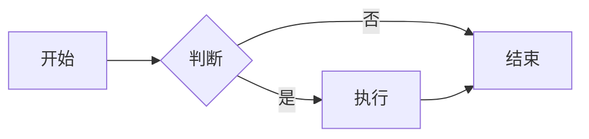

# MarkWrite 功能验证

这是一段普通文本，用于检查**粗体**、*斜体*、***粗斜体***、~~删除线~~、`行内代码` 以及 [一条链接](https://example.com) 的渲染效果。

## 二级标题

### 三级标题

#### 四级标题

> 这是一段引用文字。
> 引用的第二行，用来检查左侧竖线与缩进。

---

## 列表

- 无序列表第一项
- 无序列表第二项，带 **强调**
  - 嵌套的子项 A
  - 嵌套的子项 B
- 无序列表第三项

1. 有序列表第一项
2. 有序列表第二项
3. 有序列表第三项

- [ ] 待办事项：尚未完成
- [x] 待办事项：已经完成

## 代码块

```csharp
public class Demo
{
    public string Name { get; set; } = "MarkWrite";

    public void Greet() => Console.WriteLine($"Hello, {Name}");
}
```

```javascript
const blocks = parseBlocks(markdown);
blocks.forEach((b) => console.log(b.type));
```

## 表格

| 功能 | 状态 | 说明 |
| --- | :---: | --- |
| 块级渲染 | 完成 | 双态切换 |
| 表格编辑 | 完成 | 点击单元格进入源码 |
| 公式 | 完成 | KaTeX |
| 图表 | 完成 | Mermaid |

## 数学公式

行内公式：质能方程 $E = mc^2$ 写在句子里。

$$
\int_{0}^{\infty} e^{-x^2} \, dx = \frac{\sqrt{\pi}}{2}
$$

## Mermaid 图表



## 结尾

最后一段文字，用于确认文档末尾的排版与滚动位置。
