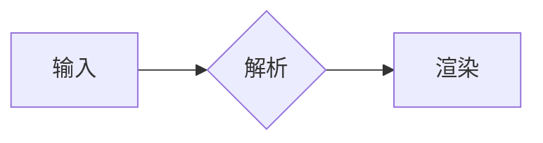

# 渲染自检

```csharp
var app = new MarkWrite();
Console.WriteLine(app.Title);
```

```python
def greet(name):
    return f"Hello, {name}"
```

行内公式 $E = mc^2$

$$
a^2 + b^2 = c^2
$$



| 组件 | 依赖 |
| --- | --- |
| 公式 | KaTeX |
| 图表 | Mermaid |

## 图片测试

